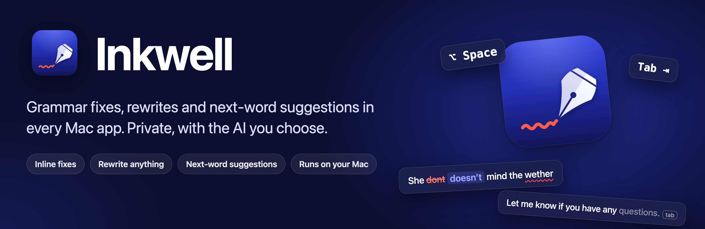
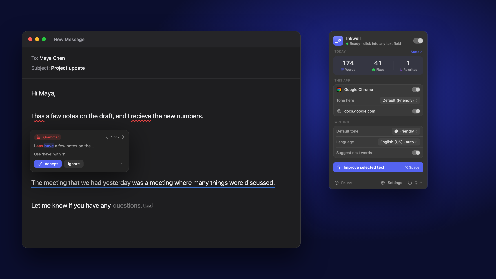
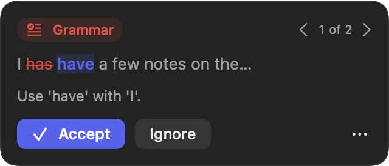
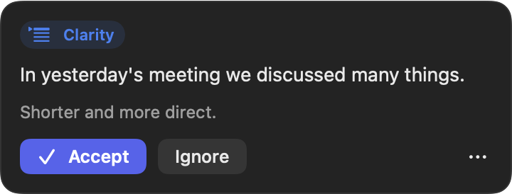
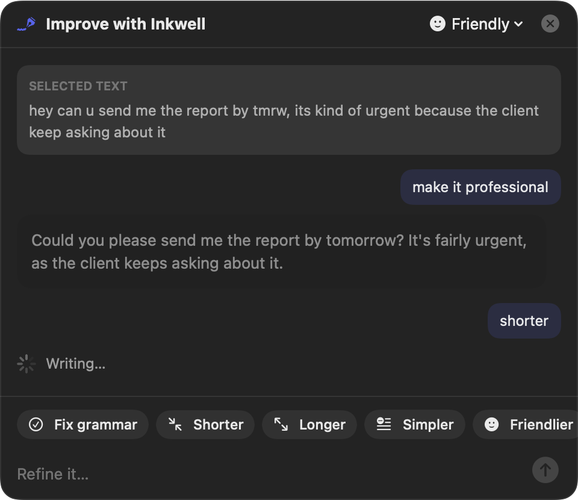
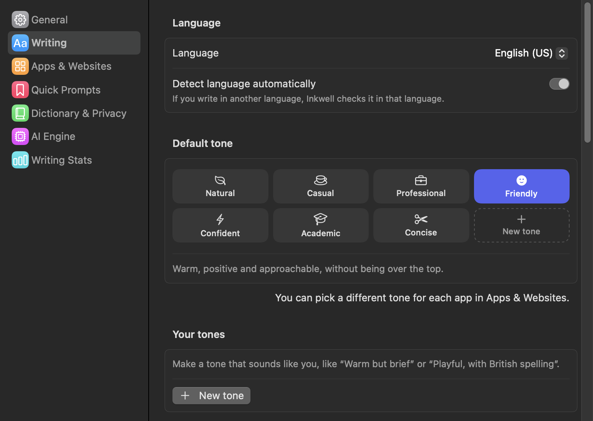
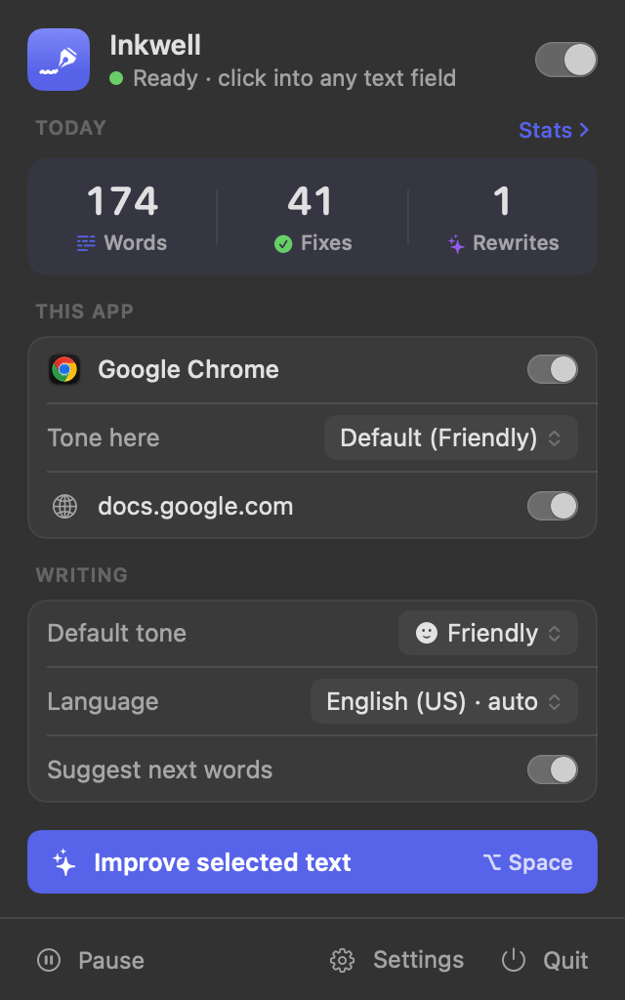
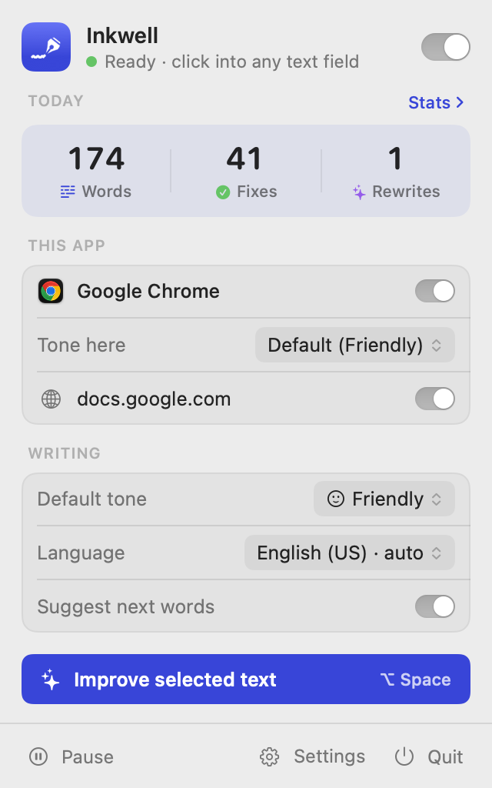
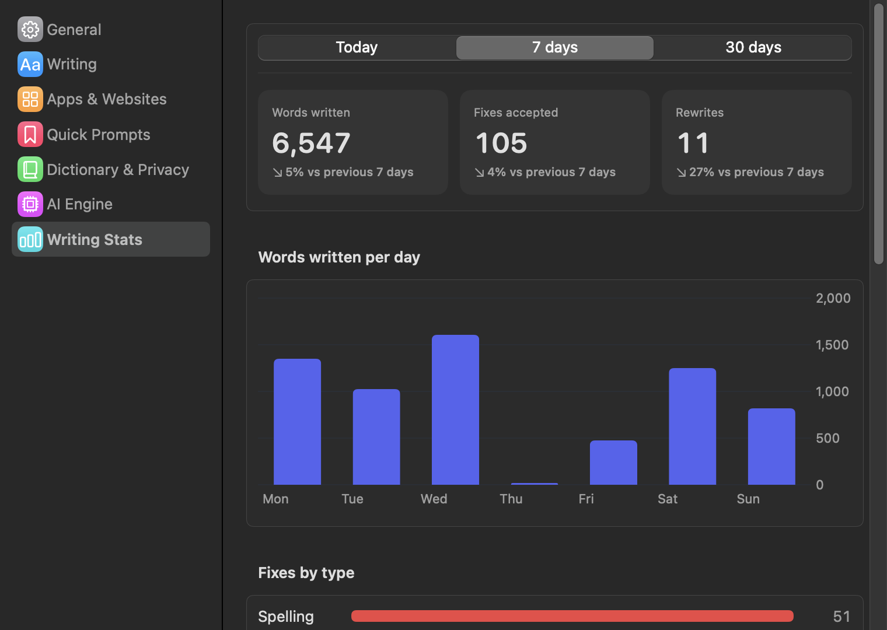

<p align="center">
  
</p>

<p align="center">
  <a href="https://github.com/jaiedsabid/Inkwell/releases/latest"></a>
  <br>
  <sub>Free and open source · macOS 15 or later · Apple silicon</sub>
</p>

<p align="center">
  <a href="https://github.com/jaiedsabid/Inkwell/releases/latest"></a>
  
  
  <a href="LICENSE"></a>
</p>

<p align="center">
  <a href="images/hero.png"></a>
</p>

## Why Inkwell

You write in a dozen apps a day. Inkwell checks all of them from the menu bar, fixes what's wrong in place, and helps you say it better, without sending your writing anywhere you didn't choose.

- ✅ **Works where you write.** Mail, Slack, Notes, Messages, browsers, Google Docs, Notion, Discord and most other Mac apps.
- ✅ **Fixes in place.** Hover an underline, press **Accept**, and the text changes right in the app. Undo is one click away.
- ✅ **Rewrite anything.** Select text, press **⌥ Space**, and ask for any change: shorter, friendlier, more professional, translated, or a reply.
- ✅ **Finishes your sentences.** Gray next-word suggestions you accept with **Tab**, shown only when Inkwell is sure.
- ✅ **Your AI, your choice.** A free local model that runs on your Mac, Apple's on-device model, or your own key for Claude, OpenAI, Gemini, OpenRouter or Ollama.
- ✅ **Private by design.** No account, no analytics, no tracking. Spelling works offline, password fields are never read, and with a local model nothing you write leaves your Mac.
- ✅ **Native and light.** A small Swift app that sits in the menu bar.
- ✅ **Free and open source.** MIT licensed.

## Underlines that explain themselves

Mistakes get a line under them as you type. Hover to see the fix, why it's better, and the words around it.

- **Red wavy line:** spelling or grammar.
- **Blue line:** a sentence that could be clearer or shorter.
- **Purple dashed line:** a sentence that doesn't fit your tone (optional).

<p align="center">
  <a href="images/card-word.png"></a>
  &nbsp;&nbsp;
  <a href="images/card-sentence.png"></a>
</p>

Accept, Ignore, **Fix all** for the whole field, **Add to dictionary**, or turn off a kind of suggestion from the card's **•••** menu. Spelling, a/an, doubled words, commonly confused words, spacing and wordy phrases are caught instantly, even without AI.

## Improve selected text

Select text in any app and press **⌥ Space** (you can change the shortcut). Ask for what you want in your own words, refine it as many times as you like, then press **Accept** to put it back where it was.

<p align="center">
  <a href="images/chat.png"></a>
</p>

- One-click actions: **Fix grammar**, **Shorter**, **Longer**, **Simpler**, **Friendlier**, **Professional**, **Confident**.
- **Translate** into any of 19 languages, or **Draft a reply** to a message you selected.
- Save your own prompts as chips.
- With nothing selected, it writes new text at the cursor.

## Next-word suggestions

As you type, Inkwell suggests the next few words in gray. Press **Tab** to accept, **→** to take one word, **Esc** to dismiss. Suggestions only show when they're very likely, never invent names, numbers or dates, and match the way you write in that app, whether that's an email or a chat message.

<p align="center">
  <a href="images/ghost-dark.png"></a>
  <br>
  <a href="images/ghost-light.png"></a>
</p>

Choose a single word, a short phrase or the rest of the sentence. With a local model, Inkwell reads the model's own confidence for every word and stops where it's unsure.

## Tones and languages

Pick a default tone (Natural, Casual, Professional, Friendly, Confident, Academic or Concise), make your own like *"Warm but brief"*, and set a different tone for each app: casual in Slack, professional in Mail. Inkwell checks 19 languages and can detect the one you're writing in.

<p align="center">
  <a href="images/settings-writing.png"></a>
</p>

## The menu bar

Everything you change often is one click away: turn Inkwell off everywhere, pause it for 30 minutes, an hour or until tomorrow, switch it off for the current app or website, change the tone there, and see today's numbers.

<p align="center">
  <a href="images/menu.png"></a>
  &nbsp;&nbsp;
  <a href="images/menu-light.png"></a>
</p>

## Writing stats

Words written, fixes accepted, rewrites, your most common mistakes and where you write most, for today, 7 days or 30 days. Only counts are kept, on your Mac, and you can turn them off.

<p align="center">
  <a href="images/settings-stats.png"></a>
</p>

## Choose your AI

Spelling and the instant checks work with no AI at all. For grammar, clarity, rewrites and suggestions, pick one:

| Engine | Cost | Where your text goes |
|---|---|---|
| **Local model** (Gemma 4, Qwen 3.5, Llama 3.x, or any GGUF from Hugging Face) | Free | Nowhere. Runs on your Mac with the bundled llama.cpp. Inkwell recommends a model for your Mac's memory. |
| **Apple on-device** (macOS 26 with Apple Intelligence) | Free | Nowhere. |
| **Ollama** | Free | Nowhere, if Ollama runs on your Mac. |
| **Anthropic, OpenAI, Google Gemini, OpenRouter** | Your own API key | To the provider you chose, under their terms. Keys are stored in the macOS Keychain. |

## Install

**Requirements:** a Mac with Apple silicon (M1 or later) running macOS 15 (Sequoia) or later.

1. Download `Inkwell-<version>.dmg` from the [latest release](https://github.com/jaiedsabid/Inkwell/releases/latest).
2. Open it and drag **Inkwell** to **Applications**.
3. Open Inkwell. It lives in your menu bar.
4. macOS may say it can't verify the app, because releases are not yet notarized by Apple. You confirm once:
   - **macOS 15 (Sequoia) or later:** double-click Inkwell and click **Done**. Then open **System Settings → Privacy & Security**, scroll to **Security**, click **Open Anyway** next to "Inkwell was blocked", and confirm with your password or Touch ID.
   - **Any version, from Terminal:** `xattr -dr com.apple.quarantine /Applications/Inkwell.app`
5. The welcome window walks you through allowing Inkwell under **System Settings → Privacy & Security → Accessibility**. That is what lets it read the field you're typing in and apply fixes.
6. Pick an AI in **Settings → AI Engine**. The local model Inkwell recommends is a good start.

**Don't see the menu bar icon?** On a MacBook with a notch, macOS hides menu bar icons when the app in front has a long menu row. Open Inkwell again from Applications or Spotlight to bring up its settings, or switch to an app with fewer menus.

### Updates

Inkwell checks for a new version once a day and asks before installing anything. To check now, open **Settings → General → Check for Updates…**; you can also switch automatic checks off there. Updates are signed, and Inkwell verifies the signature before installing. Your settings, dictionary and models are kept, and so is the Accessibility permission.

### Uninstall

Quit Inkwell from its menu, drag it from Applications to the Trash, and if you like remove its data: `~/Library/Application Support/Inkwell` (downloaded models and stats), `~/Library/Preferences/app.inkwell.mac.plist` and `~/Library/Logs/Inkwell.log`. API keys are in Keychain Access under "app.inkwell.mac.apikey".

## Privacy

- Inkwell reads the text field you're typing in through the macOS Accessibility API. **Password fields are never read**, and password managers and terminals are switched off by default. You can switch Inkwell off for any app or website.
- Spelling and the instant checks run offline. With a local model, Apple's on-device model or a local Ollama, nothing you write leaves your Mac.
- With a cloud provider, the sentences being checked or rewritten are sent to that provider with your key, and nothing else.
- No analytics, no crash reporting, no account, no ads. The only other network use is downloading a model from Hugging Face when you ask for one, and the update check: once a day, a request for the update feed on GitHub (switch it off in Settings → General).
- Settings, your dictionary and writing stats (counts only, never your text) stay in your user folder. API keys are kept in the Keychain.
- Accepting a fix doesn't go through your clipboard, so clipboard managers don't fill up with Inkwell's edits.

## Build from source

Needs only the Command Line Tools (no Xcode) on macOS 15 or later. `build.sh` downloads the pinned llama.cpp framework (checked by SHA-256) into `Vendor/` the first time.

```bash
./build.sh                       # dist/Inkwell.app and dist/Inkwell.dmg
SKIP_DMG=1 ./build.sh            # the app only
.build/release/Inkwell --selftest
.build/debug/Inkwell --snapshot /tmp/inkwell-shots           # renders the main screens to PNG
dist/Inkwell.app/Contents/MacOS/Inkwell --localtest gemma4-e2b   # downloads a model and runs checks and suggestions
```

Run `scripts/signing_identity.sh create` once so every build has the same signature; otherwise macOS asks for Accessibility again after each build. More in [docs/development.md](docs/development.md). Releases are made with `scripts/release.sh` (see [CHANGELOG.md](CHANGELOG.md)): it builds the DMG, signs it for [Sparkle](https://sparkle-project.org) with the update key in the Keychain, and attaches `appcast.xml` to the GitHub release, where the app looks for updates.

## Support

- **Something wrong?** [Open an issue](https://github.com/jaiedsabid/Inkwell/issues/new/choose) with your Inkwell and macOS versions and the app you were writing in.
- **Idea?** Open an issue too. Requests are read and answered.
- **Security or privacy problem?** Email instead of opening a public issue. See [SECURITY.md](SECURITY.md).
- Pull requests are welcome. For anything big, open an issue first so we can agree on the approach.

---

<p align="center"><sub>© 2026 Inkwell · <a href="LICENSE">MIT License</a></sub></p>
